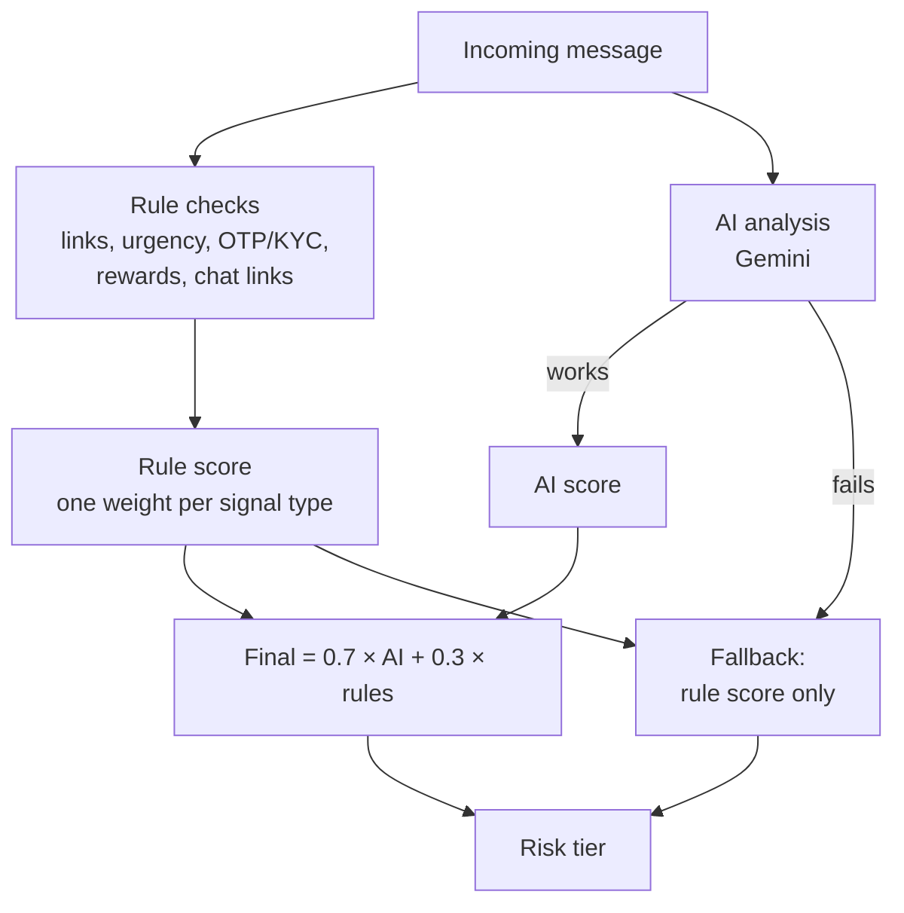
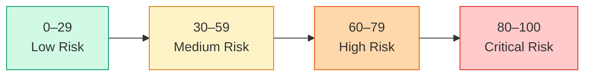
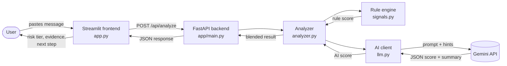
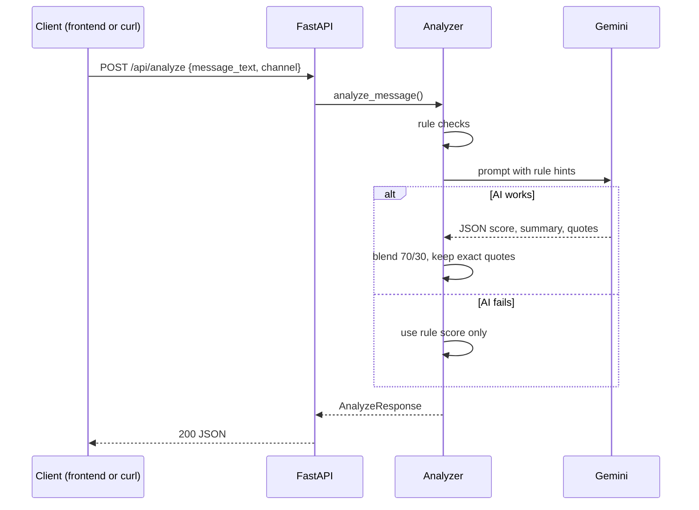

# TRUSTLENS

**See the threat before you click.** TRUSTLENS checks suspicious messages (SMS, WhatsApp, email) for phishing and social-engineering scams, with a focus on Indian scam patterns, including Hindi and Hinglish.

It never opens links. It analyses the text only and tells you why a message looks risky, what text triggered the warning, and what to do next.

---

## What it detects

- **Suspicious links:** lookalike bank and government domains (`sbi-kyc-update.xyz`, `aadhar-pan-link.com`), raw IP addresses, messaging-app links used to move victims into private chats, and fake government sites.
- **Urgency and threats:** "account will be blocked", "within 2 hours", "terminated", and Hindi and Hinglish equivalents such as "turant" and "band ho jayega".
- **Requests for sensitive data:** OTP, UPI PIN, KYC, PAN/Aadhaar verification.
- **Rewards and lures:** cashback, lottery and prize claims, part-time job and "earn per day" offers, customs and courier fees.

Each result includes a risk score (0 to 100), a risk tier, the exact text that triggered each warning, and a recommended next step.

## How scoring works

1. **Rule checks** scan the message for the patterns above. Each type of signal counts once, at its strongest match, so repeated words don't inflate the score.
2. **An AI model** (Google Gemini) reads the message with those hints and gives its own score and summary.
3. **The final score** is 70% AI and 30% rules. If the AI is unavailable, the rule score is used alone, and the summary says so.



Risk tiers:



| Score | Tier |
|---|---|
| 0–29 | Low Risk |
| 30–59 | Medium Risk |
| 60–79 | High Risk |
| 80–100 | Critical Risk |

---

## Architecture



---

## Project layout

```
.
├── app.py                     # Streamlit frontend
├── app/
│   ├── main.py                # FastAPI routes and CORS
│   ├── models.py              # Request and response schemas (the API contract)
│   └── services/
│       ├── analyzer.py        # Combines rules and AI into the final result
│       ├── signals.py         # Rule-based detectors
│       ├── llm.py             # AI client (Gemini or OpenAI-compatible providers)
│       └── feedback.py        # Saves false-alarm reports
├── prompts/
│   └── analysis_prompt.txt    # Instructions for the AI model
├── data_config.py             # Test dataset (50 messages)
├── eval/
│   └── run_rules_eval.py      # Checks the rules against the dataset
├── tests/                     # Automated tests
├── .env.example               # Settings template (copy to .env)
└── requirements.txt
```

---

## Setup

You need Python 3.11 or newer and Git.

```bash
git clone https://github.com/Amiteshiitm0820/Parallax-SyntaxError.git
cd Parallax-SyntaxError

python -m venv .venv
source .venv/bin/activate          # Windows Git Bash: source .venv/Scripts/activate
pip install -r requirements.txt

cp .env.example .env
```

Open `.env` and set your key:

```
LLM_PROVIDER=gemini
GEMINI_API_KEY=your_key_here
GEMINI_MODEL=gemini-3.5-flash-lite
```

Get a key from [Google AI Studio](https://aistudio.google.com). Never commit `.env`. It's already listed in `.gitignore`.

To run without an AI key, set `LLM_PROVIDER=mock`. Scores then come from the rules only.

---

## Running it

Start the backend in one terminal:

```bash
python -m uvicorn app.main:app --reload
```

Then start the frontend in a second terminal:

```bash
python -m streamlit run app.py
```

- Frontend: http://localhost:8501
- Backend API docs: http://localhost:8000/docs

The backend must be running for the frontend to analyse messages. Check the sidebar shows "Backend online".

---

## API



| Method | Path | Purpose |
|---|---|---|
| GET | `/health` | Returns `{"status": "ok"}` |
| POST | `/api/analyze` | Analyses a message |
| POST | `/api/report-false-positive` | Saves a feedback report |

Example request:

```json
{
  "message_text": "URGENT: Your SBI account will be blocked. Verify KYC at http://sbi-kyc-update.xyz",
  "channel": "sms"
}
```

Example response (shortened):

```json
{
  "analysis_id": "3d90fbd4-...",
  "risk_score": 92,
  "risk_tier": "Critical Risk",
  "language": "English",
  "summary": "Impersonates a bank to pressure the reader into submitting KYC details.",
  "evidence_highlights": [
    {"quote": "http://sbi-kyc-update.xyz", "type": "Domain Inconsistency", "reason": "..."}
  ],
  "recommended_action": "Do not click the link. Contact your bank on its official number."
}
```

`evidence_highlights.quote` is always an exact substring of the message, so it can be highlighted in the original text.

Errors: `400` for empty text, `422` for a malformed request, `503` if the AI service is misconfigured.

---

## Testing

Run the automated tests:

```bash
python -m pytest -q
```

Run the rule checks against the full 50-message dataset:

```bash
python -m eval.run_rules_eval
```

This prints how many phishing messages are caught and lists any misses. It also writes `eval/rules_only_results.csv`, which is generated and not committed.

---

## Known limitations

- Character substitution tricks (zero for o, capital I for l) are not detected by the rules.
- The AI score depends on the provider's availability and free-tier limits. When it's unavailable, the score falls back to rules only.
- The backend runs on your computer. For a shared demo, it has to be deployed somewhere that stays online.
- Feedback reports are saved to `data/feedback.jsonl` on the backend machine. There's no review page yet.
- This is a student project. It's a helpful first check, not a replacement for your bank's official channels.

---

## Safety

Never share an OTP, UPI PIN, or password, even with someone claiming to be from your bank. If you lose money to fraud in India, call **1930** or report at **cybercrime.gov.in**.

---

## Team

Work happens on feature branches, with pull requests into `main`. Use clear commit messages describing the change.
