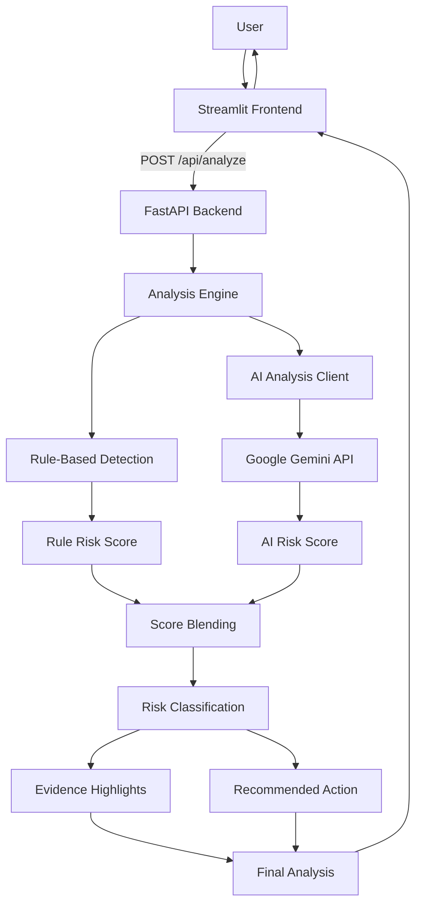
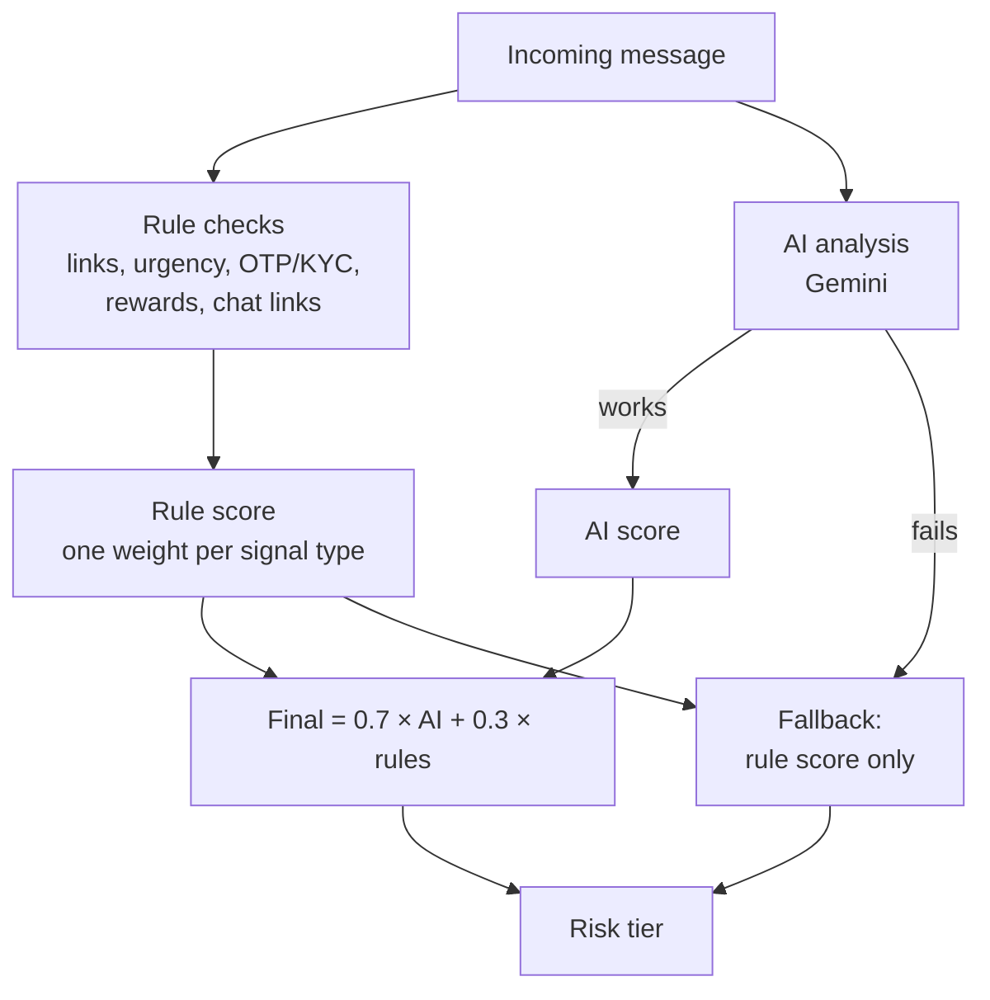
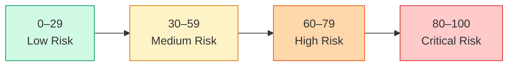
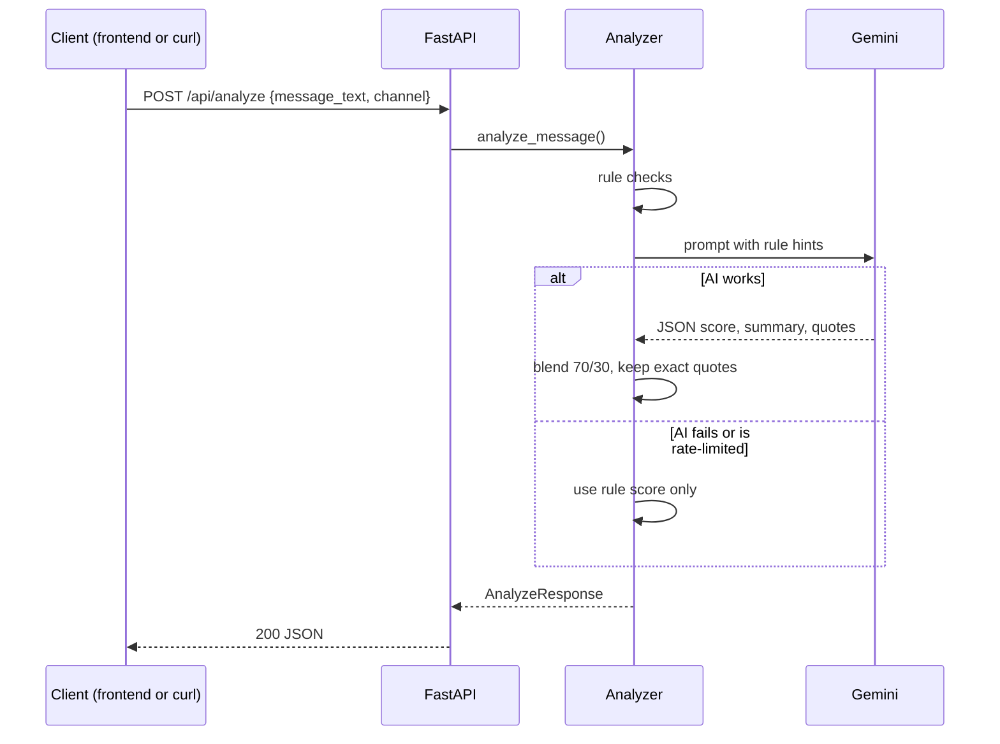

# TRUSTLENS
### See the threat before you click.

**An explainable, multilingual phishing and social-engineering detection system designed for India's digital ecosystem.**

[Live Demo](https://trustlens-frontend-t3lg.onrender.com/) · [Backend API](https://trustlens-backend-q0oj.onrender.com/) · [GitHub Repository](https://github.com/Amiteshiitm0820/Parallax-SyntaxError)

---

## 1. The Problem: Why TRUSTLENS?

India's rapidly growing digital economy has also created opportunities for increasingly sophisticated cyber fraud.

Millions of people use SMS, WhatsApp, UPI and email for everyday transactions. Cybercriminals exploit this reliance through phishing messages, impersonation, fake KYC notifications, fraudulent payment requests and social-engineering techniques.

These attacks often exploit three things:

- **Urgency:** Threatening account suspension or immediate consequences.
- **Trust:** Impersonating banks, government departments, delivery services and familiar organisations.
- **Manipulation:** Offering fake rewards, employment opportunities or financial benefits.

A particularly important challenge in India is the use of Hindi, Hinglish and regional communication patterns in scam messages. Conventional phishing detection approaches may fail to recognise these contextual signals.

**Our solution:** TRUSTLENS analyses suspicious messages, identifies potential manipulation techniques and explains exactly why a message may be dangerous.

## 2. Our Solution

TRUSTLENS is an AI-assisted phishing and social-engineering detection platform.

Users can paste suspicious SMS, WhatsApp messages or emails into the application and receive an explainable security assessment.

Instead of simply labelling a message as safe or dangerous, TRUSTLENS provides:

- A risk score between 0 and 100.
- A categorised risk level.
- Exact excerpts from the message that triggered warnings.
- Explanations of suspicious patterns.
- Actionable recommendations to help users respond safely.
- Support for Indian scam patterns, including Hindi and Hinglish expressions.

**Our core principle: Detection should be explainable, not just predictive.**

### Live Application

[Try TRUSTLENS](https://trustlens-frontend-t3lg.onrender.com/)

[Backend API](https://trustlens-backend-q0oj.onrender.com/)

_Add screenshots of the home screen, analysis input and a completed threat analysis here._

---

## 3. Threat Model & Security Relevance

### Who are we protecting?

Our primary target users are everyday smartphone and internet users, particularly those who may not have the technical knowledge to recognise phishing and social-engineering attacks.

Potential beneficiaries include:

- Digital banking and UPI users.
- Students and first-time internet users.
- Senior citizens.
- Small business owners.
- Individuals receiving frequent transactional SMS and WhatsApp messages.

### What are we protecting?

The primary assets at risk include:

- Banking credentials and account access.
- UPI PINs and OTPs.
- Personal identification information, including PAN and Aadhaar details.
- Financial assets.
- Personal and organisational information.

### Who are the threat actors?

TRUSTLENS focuses on identifying patterns associated with:

- Phishing campaign operators.
- Financial fraudsters impersonating legitimate institutions.
- Social-engineering attackers.
- Fake recruitment and investment scheme operators.
- Impersonators using fraudulent government or banking websites.

### Attack pathways

| Attack technique | Potential consequence |
|---|---|
| Fake banking KYC notifications | Credential theft |
| OTP and UPI PIN requests | Financial account compromise |
| Fake government websites | Personal information theft |
| Fraudulent job offers | Financial exploitation |
| Fake cashback and lottery messages | Payment fraud |
| Urgent account suspension threats | Manipulated decision-making |

**Security objective:** Reduce the likelihood of users trusting malicious messages by identifying suspicious signals before they interact with them.

---

## 4. Detection Capabilities

TRUSTLENS combines rule-based detection with AI-assisted contextual analysis.

### A. Suspicious links and domain impersonation

Identifies potentially fraudulent links, including:

- Lookalike banking domains.
- Fake government and verification websites.
- Lookalike domains that swap characters (for example `0` for `o`, `1` for `l`, or capital `I` for `l`) to imitate a known name.
- Raw IP-address-based links.
- Suspicious shortened or redirected-looking URLs.
- Messaging-platform links used to move conversations elsewhere.

Examples:

- `sbi-kyc-update.xyz`
- `aadhar-pan-link.com`
- `netfIix.com` (imitates Netflix)

### B. Urgency and psychological manipulation

Detects language designed to pressure users into acting without verification.

Examples:

- "Your account will be blocked."
- "Verify within 2 hours."
- "Immediate action required."
- Hindi/Hinglish expressions such as "turant" and "band ho jayega".

### C. Sensitive information requests

Identifies requests involving:

- OTPs.
- UPI PINs.
- Banking credentials.
- PAN and Aadhaar information.
- KYC verification.

### D. Financial lures and fraudulent offers

Detects suspicious claims involving:

- Cashback and lottery rewards.
- Fake prize notifications.
- Part-time job opportunities.
- Unrealistic daily earning promises.
- Fake customs and courier charges.

### E. QR code lures (optional extension)

Flags messages that push users to scan a QR code to "receive" money or "verify" an account, in English and Hindi.

### How the rule score works

Each signal type counts once, at its strongest match, so repeated words don't inflate the score. A small bonus applies when several different signal types fire together. The total is capped at 100.

---

## 5. Technical Architecture

TRUSTLENS uses a modular architecture that combines deterministic security rules with contextual AI analysis.

### System architecture



### Technology stack

| Component | Technology |
|---|---|
| Frontend | Python, Streamlit |
| Backend | Python, FastAPI |
| AI integration | Google Gemini API |
| Validation | Pydantic |
| Rule engine | Custom Python detection logic |
| API communication | HTTP / JSON |
| Testing | Pytest |
| Deployment | Render |

### Analysis pipeline

**Step 1: User input**

The user submits a suspicious message and selects its communication channel.

**Step 2: Rule-based analysis**

The rule engine checks for suspicious links, urgency, sensitive-data requests and fraudulent offers.

Each signal category contributes according to its configured weight. Repeated matches within a category do not automatically inflate its contribution.

**Step 3: AI-assisted contextual analysis**

Google Gemini analyses the message with the detected rule signals as additional context.

It evaluates the message's language, intent and possible social-engineering techniques.

**Step 4: Score aggregation**

When AI analysis succeeds:

`Final Score = (0.7 × AI Score) + (0.3 × Rule Score)`

When AI analysis is unavailable, the system falls back to the rule-based score.



**Step 5: Explainable output**

The final response includes the risk classification, evidence highlights and recommended next steps.

---

## 6. Risk Classification

| Score | Classification | Interpretation |
|---|---|---|
| 0–29 | Low Risk | Few suspicious indicators detected |
| 30–59 | Medium Risk | Potentially suspicious patterns |
| 60–79 | High Risk | Multiple concerning indicators |
| 80–100 | Critical Risk | Strong indicators of a malicious message |



Risk scores are indicators, not guarantees. A low-risk result does not establish that a message is legitimate.

---

## 7. What Makes TRUSTLENS Different?

Our approach focuses on explainability, contextual detection and the Indian digital environment.

### 1. Indian-contextual scam detection

Rather than focusing exclusively on conventional English-language phishing patterns, TRUSTLENS incorporates Hindi and Hinglish scam expressions commonly used in social engineering.

### 2. Hybrid detection architecture

Combining deterministic rules with AI analysis allows the system to consider both identifiable suspicious patterns and contextual manipulation.

The rule engine also provides a fallback when the external AI service is unavailable.

### 3. Evidence-based explanations

TRUSTLENS does not simply return a risk score.

It identifies the exact text that triggered warnings and explains why that text is suspicious.

Evidence excerpts are validated against the original message so that highlighted text can be traced back to the user's input.

### 4. Privacy-conscious design

TRUSTLENS analyses message text without opening suspicious links.

It does not need to navigate to a potentially malicious website to identify suspicious message patterns.

---

## 8. Security Testing & Evaluation

Security effectiveness must be demonstrated through repeatable testing rather than assumed from successful demonstrations.

TRUSTLENS includes an evaluation dataset of 50 messages and a rule-engine evaluation script.

### Testing methodology

Our evaluation covers three categories:

| Category | Purpose |
|---|---|
| Malicious test cases | Verify detection of phishing and social-engineering patterns |
| Benign controls | Check whether legitimate messages are incorrectly flagged |
| Edge cases | Evaluate ambiguous wording, multilingual messages and obfuscated domains |

### Metrics

| Metric | What it measures |
|---|---|
| True Positives (TP) | Malicious messages correctly detected |
| True Negatives (TN) | Benign messages correctly classified |
| False Positives (FP) | Benign messages incorrectly flagged |
| False Negatives (FN) | Malicious messages missed |

Important evaluation metrics:

- **Precision:** How many flagged messages were actually malicious?
- **Recall:** How many malicious messages were successfully detected?
- **F1 Score:** Balance between precision and recall.

To reproduce the results, run `python -m eval.run_rules_eval`. It prints recall and false-alarm counts for each dataset group and writes a summary table to `eval/results_summary.md`.

### Failure cases and limitations

We recognise that no phishing detection system can identify every malicious message.

Known limitations include:

- Rule-based checks only cover known look-alike patterns (digits and symbols swapped for letters). New tricks may evade them.
- AI-generated scores depend on external API availability. When the AI is rate-limited or unavailable, the result uses rule checks only and is labelled as such.
- Context-dependent messages may produce ambiguous classifications.
- A malicious message without obvious suspicious indicators may go undetected.
- The current dataset is limited and was used to tune the rules, so results on it overstate real-world accuracy. Broader, unseen test data is needed.

These limitations guide future development and testing.

---

## 9. Safety, Privacy & Responsible Engineering

TRUSTLENS follows a defensive security approach.

### Safe-by-design principles

- **No automatic link opening:** Suspicious URLs are analysed as text, not visited.
- **No interaction with suspicious senders:** The platform does not contact potential attackers.
- **No credential collection:** Users are warned against sharing OTPs, passwords and UPI PINs.
- **Transparent limitations:** Risk classifications are presented as assessments rather than guarantees.
- **Defensive testing:** Evaluation uses controlled test messages and benign controls.

### Data handling

Message processing involves the configured AI provider when AI analysis is enabled. Therefore, users should not submit real credentials, OTPs, passwords or other sensitive personal information.

Feedback reports are handled separately from the analysis workflow.

Deployment and data-retention behaviour should be documented according to the actual backend configuration.

---

## 10. Real-World Impact & Future Scope

TRUSTLENS aims to make basic phishing awareness more accessible to users who may not have cybersecurity expertise.

Potential future improvements include:

- Browser extension for suspicious-message awareness.
- WhatsApp and SMS integration through authorised interfaces.
- Expanded regional-language detection.
- Improved detection of character substitution and obfuscated URLs.
- Larger multilingual evaluation datasets.
- Improved contextual analysis of emerging Indian scam patterns.
- Voice-call deepfake checks on a separate page.
- A feedback dashboard for reviewing false positives and improving detection rules.

The long-term goal is to make TRUSTLENS a practical first layer of protection against everyday digital fraud.

---

## 11. API Reference

| Method | Endpoint | Description |
|---|---|---|
| GET | `/health` | Backend health check |
| POST | `/api/analyze` | Analyse a suspicious message |
| POST | `/api/report-false-positive` | Submit a false-positive report |



### Example request

```json
{
  "message_text": "URGENT: Your SBI account will be blocked. Verify KYC at http://sbi-kyc-update.xyz",
  "channel": "sms"
}
```

### Example response

```json
{
  "analysis_id": "3d90fbd4-...",
  "risk_score": 92,
  "risk_tier": "Critical Risk",
  "language": "English",
  "summary": "Impersonates a bank to pressure the reader into submitting KYC details.",
  "evidence_highlights": [
    {
      "quote": "http://sbi-kyc-update.xyz",
      "type": "Domain Inconsistency",
      "reason": "The domain appears inconsistent with the claimed banking identity."
    }
  ],
  "recommended_action": "Do not click the link. Contact your bank through its official channels."
}
```

`evidence_highlights.quote` is always an exact substring of the message, so it can be highlighted in the original text.

**Errors:** `400` for empty text, `422` for a malformed request, `503` if the AI service is misconfigured.

---

## 12. Installation & Local Setup

### Requirements

- Python 3.11+
- Git
- Gemini API key (optional when using mock mode)

### Clone the repository

```bash
git clone https://github.com/Amiteshiitm0820/Parallax-SyntaxError.git

cd Parallax-SyntaxError
```

### Create a virtual environment

```bash
python -m venv .venv
```

Activate it:

```bash
# Windows (Git Bash)
source .venv/Scripts/activate

# Windows (PowerShell / Command Prompt)
.venv\Scripts\activate

# macOS/Linux
source .venv/bin/activate
```

### Install dependencies

```bash
pip install -r requirements.txt
```

### Configure environment variables

Create a `.env` file based on `.env.example`.

```env
LLM_PROVIDER=gemini
GEMINI_API_KEY=your_key_here
GEMINI_MODEL=gemini-3.5-flash-lite
```

Never commit API keys or `.env` files.

For rule-only testing without an AI key:

```env
LLM_PROVIDER=mock
```

### Start the backend

```bash
python -m uvicorn app.main:app --reload
```

### Start the frontend

In a separate terminal:

```bash
python -m streamlit run app.py
```

Frontend: `http://localhost:8501`

Backend documentation: `http://localhost:8000/docs`

The backend must be running for the frontend to analyse messages. If it isn't, the page shows a "Cannot reach the TRUSTLENS backend" message.

---

## 13. Running Tests

Run automated tests:

```bash
python -m pytest -q
```

Run the rule-engine evaluation:

```bash
python -m eval.run_rules_eval
```

The evaluation script checks the rule engine against the provided 50-message dataset.

---

## 14. Project Structure

```text
.
├── app.py                          # Streamlit frontend (main page)
├── pages/
│   └── 1_Dashboard.py              # Feedback dashboard (optional)
├── app/
│   ├── main.py                     # FastAPI routes and CORS
│   ├── models.py                   # Request and response schemas (the API contract)
│   └── services/
│       ├── analyzer.py             # Combines rules and AI into the final result
│       ├── signals.py              # Rule-based detectors
│       ├── qr_signals.py           # QR-code lure rules (optional)
│       ├── llm.py                  # AI client (Gemini or OpenAI-compatible providers)
│       └── feedback.py             # Saves false-alarm reports
├── ui_guidance.py                  # Plain-language next steps for each risk tier
├── prompts/
│   └── analysis_prompt.txt         # Instructions for the AI model
├── data_config.py                  # 50-message test dataset
├── eval/
│   └── run_rules_eval.py           # Runs the rules over the dataset and writes a summary
├── tests/                          # Automated tests
├── .env.example                    # Settings template (copy to .env)
└── requirements.txt
```

---

## 15. Responsible Use & Emergency Reporting

TRUSTLENS is an educational cybersecurity project and should be treated as a first-level warning system, not a replacement for professional security services or official verification channels.

Never share your OTP, UPI PIN or password with anyone claiming to represent your bank.

If you experience financial cyber fraud in India:

- Call **1930**.
- Report the incident at [cybercrime.gov.in](https://cybercrime.gov.in/).

---

## 16. Team & Development

**Project:** TRUSTLENS — See the threat before you click.

**Repository:** [Parallax-SyntaxError](https://github.com/Amiteshiitm0820/Parallax-SyntaxError)

Development follows a feature-branch workflow, with pull requests into the main branch.

We believe cybersecurity tools should not only detect threats but also help people understand them.

**TRUSTLENS — Making digital safety easier to understand, one message at a time.**
